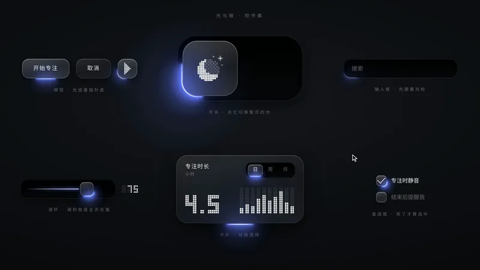
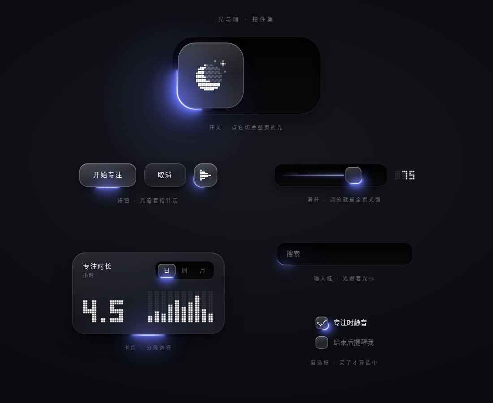
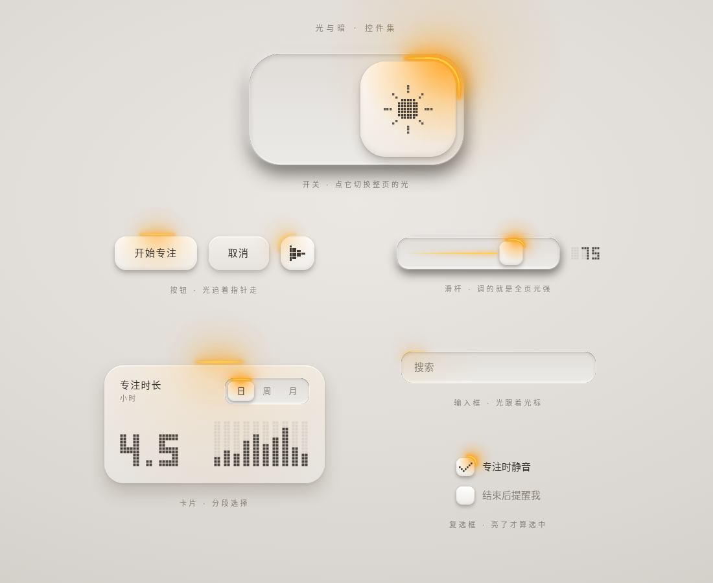

# light-kit · 光与暗

用光影做交互的一组前端控件：暗色时光在下方（蓝紫），亮色时光在上方（琥珀），光永远贴着边缘走。

原生 HTML / CSS / Canvas 2D，单文件，无依赖，无构建步骤。



带声音的完整演示视频：[media/demo.mp4](media/demo.mp4)（1920×1080，60fps，18.7 秒）

| 暗 | 亮 |
| --- | --- |
|  |  |

## 怎么用

直接用浏览器打开 `index.html` 即可，不需要安装任何东西。

- `index.html`：完整控件集
- `theme-switch/index.html`：只有主题开关的最初原型

## 控件

- **主题开关**：点它整页一起变。光弧沿滑块边缘从左下绕到右上，点阵月亮打散重组成太阳。
- **按钮**（主 / 次 / 播放暂停）：光弧沿边缘追着指针走，点击时闪一下；播放图标是点阵三角变成暂停条。
- **滑杆**：光贴在滑块上，读数是点阵数字；拖动它会调整整页所有光的强度。
- **卡片**：点阵数字加点阵柱状图，切换日 / 周 / 月时粒子打散重组。
- **输入框**：光弧跟着文字光标移动，聚焦时变亮。
- **复选框**：选中才亮，勾是点阵的。

都是原生控件（`button`、`input[type=range]`、`radio`、`checkbox`），键盘可操作，窄屏自动变成单列，尊重系统的深浅色和「减少动态效果」设置。

## 实现要点

- 全局 CSS 变量 `--p`（0 暗 → 1 亮）驱动所有材质的连续过渡，`--glow` 是当前光色。
- 光弧用 Canvas 2D 沿圆角矩形周长绘制，位置跟随指针、滑块或输入光标。
- 月亮 / 太阳、播放 / 暂停、勾、数字、柱状图都是点阵粒子，状态切换时打散重组。
- 开关、悬停、按压、滑杆、分段选择都由弹簧模型驱动，中途再点可以平滑折返。

## 演示视频是怎么做的

`video/` 里是录制脚本，画面是真实页面逐帧录的，不是重画的：

```bash
pip install playwright opencv-python-headless numpy scipy
playwright install chromium        # 需要系统里有 ffmpeg

cd video
python3 stage.py                   # 由 ../index.html 生成 16:9 的录制舞台 stage.html
python3 record.py --out demo.mp4   # 虚拟时钟逐帧截图，脚本驱动指针和镜头，输出 1080p60
python3 audio.py track.wav 1.5     # 合成背景音乐和点击音效（纯代码生成，无外部素材）
ffmpeg -i demo.mp4 -i track.wav -map 0:v -map 1:a -c:v copy -c:a aac -b:a 192k final.mp4
```

想用本机已有的 Chrome 录制，可以设置环境变量 `CHROME_PATH`。

## 兼容性

目前只在 Linux 上的无头 Chrome 里验证过，Safari、Firefox 和真机还没有测试。

## 致谢

视觉灵感来自抖音 @Ai 咖啡因 的分享「设计少即是多，图形简化把光和暗留下」。
